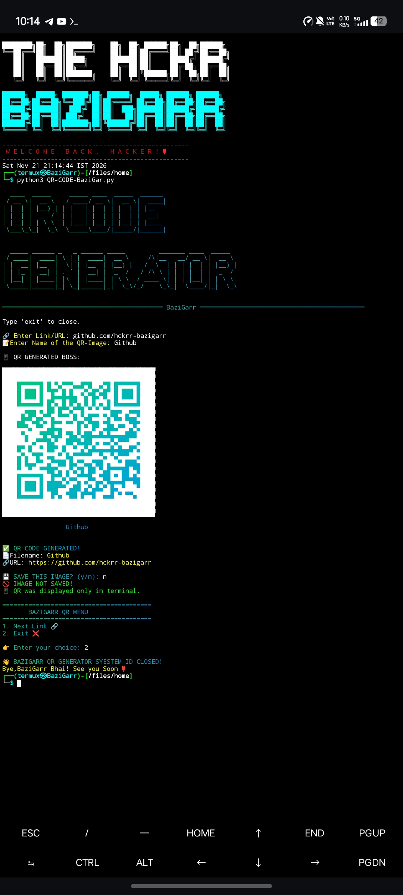

<p align="center">
  
</p>
<p align="center">
  <b>🌈 BAZIGARR QR GENERATOR</b>
  <br>
  <i>Generate • Customize • Scan</i>
</p>

<p align="center">
  
  
  
  
</p>

<p align="center">
  <b>A Stylish Green-Cyan-Blue Gradient QR Code Generator for Termux, Android and Linux.</b>
</p>

---

## 📌 About

BaziGarr QR Generator is a Python-based interactive QR code generation tool.

Generate beautiful QR codes with a modern Green → Cyan → Blue gradient, preview them directly in your terminal, and optionally save them as PNG images.

Customize filenames, generate multiple QR codes, and enjoy a colorful terminal interface.

**Simple. Stylish. Powerful. 🔥**

---

## ✨ Features

| Feature | Description |
|---|---|
| 🎨 Gradient QR | Green → Cyan → Blue design |
| 🖥️ Terminal Preview | QR preview directly in terminal |
| 🌈 Gradient Text | Colorful filename rendering |
| 🖼️ PNG Output | Save QR codes as PNG images |
| 💾 Save Option | Choose Y/N before saving |
| 🔗 URL Support | Automatically adds HTTPS when needed |
| 🔄 Multiple QR | Generate multiple QR codes |
| 📝 Custom Filename | Choose your own image name |
| 🛡️ Error Correction | High QR error correction (Level H) |
| 📂 Auto Directory | Automatically creates output folder |
| 🎭 FIGlet Banner | Terminal banner |

---

## ⚡ One-Line Quick Install

### 📱 Termux — Android

**Step 1 — Install Required Packages**

```bash
pkg update && pkg install git python figlet -y
```

**Step 2 — Clone Repository**

```bash
git clone https://github.com/hckrr-bazigarr/QR-CODE-GENRETOR.git
```

**Step 3 — Open Project Directory**

```bash
cd QR-CODE-GENRETOR
```

**Step 4 — Install Dependencies**

```bash
pip install -r requirements.txt
```

**Step 5 — Run BaziGarr QR Generator**

```bash
python3 qr-code.py
```

---

### 🐉 Kali Linux

**Step 1 — Install Required Packages**

```bash
sudo apt update && sudo apt install git python3 python3-pip python3-venv figlet -y
```

**Step 2 — Clone Repository**

```bash
git clone https://github.com/hckrr-bazigarr/QR-CODE-GENRETOR.git
```

**Step 3 — Open Project Directory**

```bash
cd QR-CODE-GENRETOR
```

**Step 4 — Create Virtual Environment**

```bash
python3 -m venv .venv
```

**Step 5 — Activate Virtual Environment**

```bash
source .venv/bin/activate
```

**Step 6 — Install Dependencies**

```bash
pip install -r requirements.txt
```

**Step 7 — Run BaziGarr QR Generator**

```bash
python3 qr-code.py
```

---

## 📲 Detailed Installation Guide

### 📱 Termux — Android

**Step 1 — Update Packages**

```bash
pkg update && pkg upgrade -y
```

**Step 2 — Install Required Packages**

```bash
pkg install git python figlet -y
```

**Step 3 — Allow Storage Permission**

```bash
termux-setup-storage
```

**Step 4 — Clone Repository**

```bash
git clone https://github.com/hckrr-bazigarr/QR-CODE-GENRETOR.git
```

**Step 5 — Open Project Directory**

```bash
cd QR-CODE-GENRETOR
```

**Step 6 — Install Python Dependencies**

```bash
pip install -r requirements.txt
```

**Step 7 — Run BaziGarr QR Generator**

```bash
python3 qr-code.py
```

---

### 🐉 Linux — Kali / Debian / Ubuntu

**Step 1 — Update System**

```bash
sudo apt update && sudo apt upgrade -y
```

**Step 2 — Install Required Packages**

```bash
sudo apt install git python3 python3-pip python3-venv figlet -y
```

**Step 3 — Clone Repository**

```bash
git clone https://github.com/hckrr-bazigarr/QR-CODE-GENRETOR.git
```

**Step 4 — Open Project Directory**

```bash
cd QR-CODE-GENRETOR
```

**Step 5 — Create Virtual Environment**

```bash
python3 -m venv .venv
```

**Step 6 — Activate Virtual Environment**

```bash
source .venv/bin/activate
```

**Step 7 — Install Dependencies**

```bash
pip install -r requirements.txt
```

**Step 8 — Run BaziGarr QR Generator**

```bash
python3 qr-code.py
```

---

## 📸 Terminal Preview

<p align="center">
  
</p>

<p align="center">
  <b>Beautiful Gradient QR Codes Directly in Your Terminal.</b>
</p>

---

## 🎯 How to Use

**1. Enter Your URL**

Enter your link or URL:

```text
https://github.com
```

**2. Enter Image Filename**

Choose your preferred QR image filename.

**3. Preview Your QR Code**

Your generated QR code will appear directly in the terminal.

**4. Save Your QR Image**

```text
SAVE THIS IMAGE? (y/n):
```

- `y` — Save the QR image.
- `n` — Skip saving the QR image.

**5. Generate Another QR Code**

1. Next Link
2. Exit

Choose `1` to generate another QR code or `2` to exit.

---

## 📂 Output Location

Generated QR images are saved in:

```text
/storage/emulated/0/Pictures/QR_CODE
```

**Example Directory**

```text
Pictures/
└── QR_CODE/
    ├── GitHub.png
    ├── YouTube.png
    └── Website.png
```

**Note:** The default output directory is configured for Android shared storage. On Linux, change `SAVE_DIR` in `qr-code.py` to a suitable directory.

---

## ⚙️ Customization

Customize the QR gradient and appearance by modifying these values in `qr-code.py`:

```python
GREEN = (0, 200, 115)
CYAN = (0, 185, 180)
BLUE = (0, 155, 225)

MODULE_SIZE = 12
BORDER = 4
```

---

## 📦 Requirements

### Python Dependencies

- `qrcode[pil]`
- `Pillow`

Install all dependencies:

```bash
pip install -r requirements.txt
```

### System Dependency

FIGlet is required for the terminal banner.

**Termux:**

```bash
pkg install figlet -y
```

**Kali / Debian / Ubuntu:**

```bash
sudo apt install figlet -y
```

---

## 🛠️ Built With

| Technology | Purpose |
|---|---|
| Python 3 | Main programming language |
| qrcode | QR code generation |
| Pillow | Image processing |
| FIGlet | Terminal ASCII banner |

---

## 📁 Project Structure

```text
QR-CODE-GENRETOR/
│
├── README.md
├── requirements.txt
├── terminal-preview.jpg
└── qr-code.py
```

---

## 👨‍💻 Developer

<p align="center">
  <b>BAZIGARR</b>
  <br>
  Python Developer
  <br>
  Made with ❤️
</p>

---

## ⭐ Support the Project

If you like BaziGarr QR Generator:

- ⭐ Star this repository.
- 🍴 Fork the repository.
- 🐛 Report bugs through GitHub Issues.
- 💡 Suggest new features.
- 🤝 Contributions are welcome.

<p align="center">
  <b>🔥 BAZIGARR QR GENERATOR 🔥</b>
  <br>
  <i>Generate. Customize. Scan.</i>
  <br><br>
  Made with ❤️ by BaziGarr
</p>
